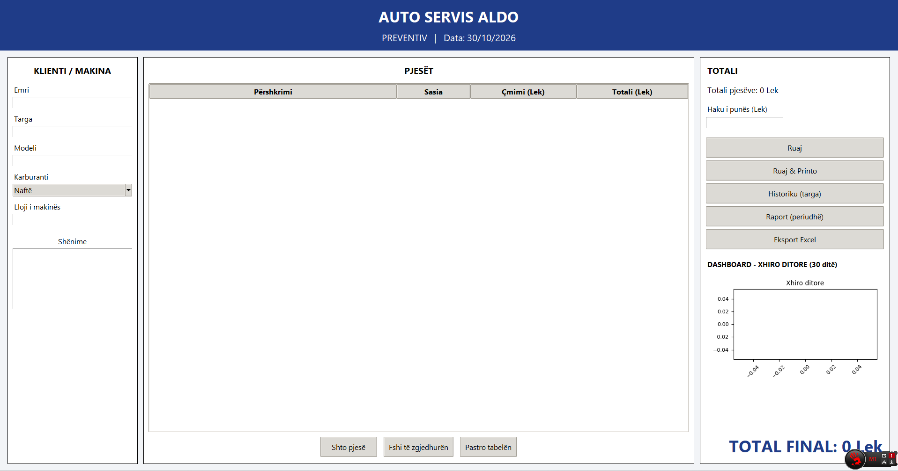
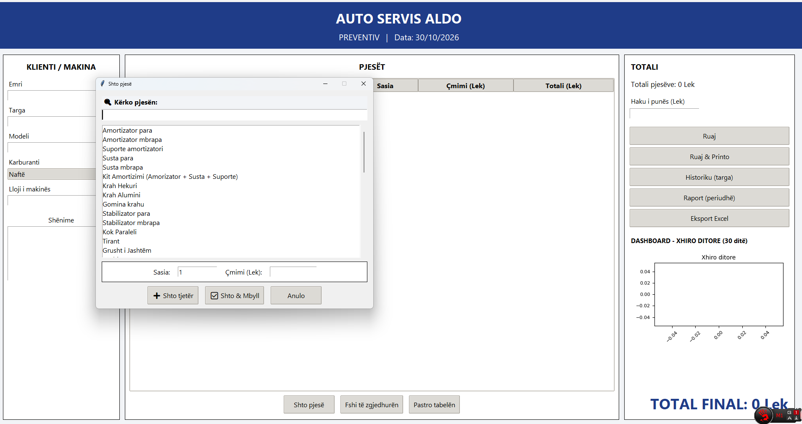

```markdown
# Auto Service Management & Quotation System

A robust Python desktop application designed specifically for automotive repair services to streamline operations, manage customer quotations, track spare parts and labor costs, and generate comprehensive financial reports.

---

## 🚀 Key Features

- **Quotation & Service Management:** Effortlessly create, update, and manage customer quotations and vehicle service records.
- **Cost Calculation Engine:** Automatically computes the total cost of vehicle repairs by combining spare parts pricing and labor expenses.
- **Database Integration:** Securely stores and manages all service records, historical quotations, and related workshop information.
- **Excel Export Functionality:** Generates detailed period-based reports (daily, monthly, and custom ranges) exported directly to Excel for simplified financial tracking.
- **Standalone PC Application:** Built for desktop environments to ensure fast, reliable, and offline-capable workshop operations.

---

## 📸 Screenshots

| Pamja Kryesore (Dashboard & Quotation) | Dritarja e Kërkimit të Pjesëve |
| :---: | :---: |
|  |  |

---

## 🛠️ Tech Stack & Requirements

- **Programming Language:** Python (Tkinter GUI)
- **Data Management:** Relational Database (PostgreSQL / SQLite)
- **Reporting & Charts:** Excel Export Libraries & Matplotlib
- **Platform:** Windows PC Desktop

---

## 📦 Installation & Setup

1. **Clone the repository:**
   ```bash
   git clone [https://github.com/EnklajdH/Auto-Service-Management-Quotation-System-Python-Desktop-Application.git](https://github.com/EnklajdH/Auto-Service-Management-Quotation-System-Python-Desktop-Application.git)

```

2. **Navigate to the project directory:**
```bash
cd Auto-Service-Management-Quotation-System-Python-Desktop-Application

```


3. **Install the required dependencies:**
```bash
pip install -r requirements.txt

```


4. **Run the application:**
```bash
python main.py

```


---

## 📄 License

This project is developed for automotive service management and is available under the MIT License.

```

---

<ElicitationsGroup message="Nëse keni nevojë për ndonjë skedar tjetër shtesë:">
  <Elicitation label="Krijo skedarin .gitignore" query="Më jep përmbajtjen e plotë për skedarin .gitignore që të shmang skedarët e panevojshëm."/>
  <Elicitation label="Krijo requirements.txt" query="Më jep listën e bibliotekave Python për skedarin requirements.txt."/>
</ElicitationsGroup>

```
